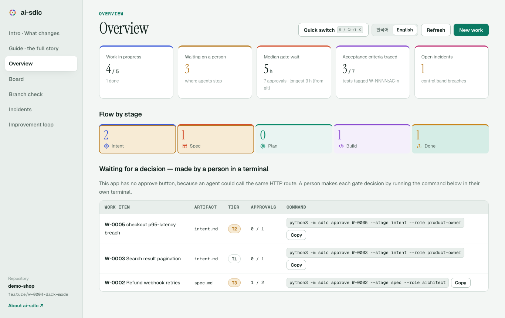
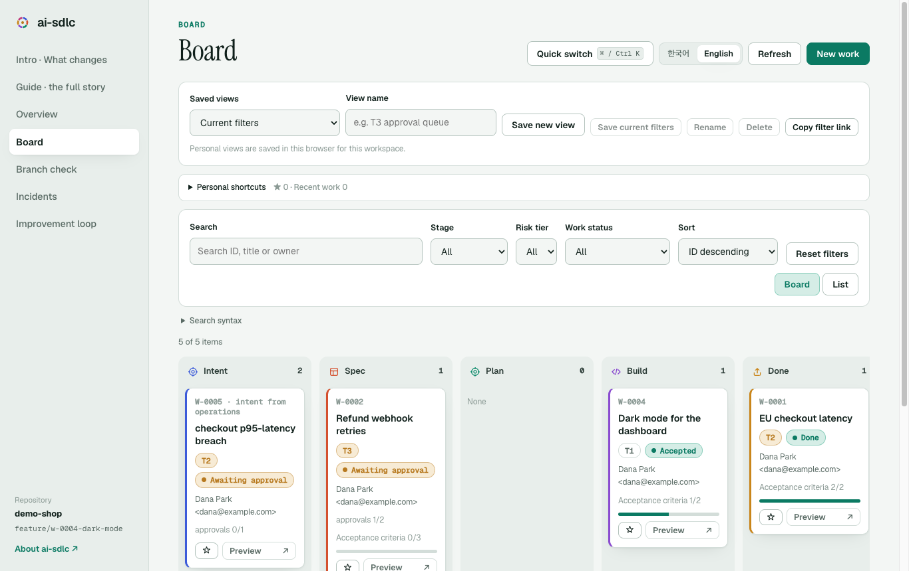
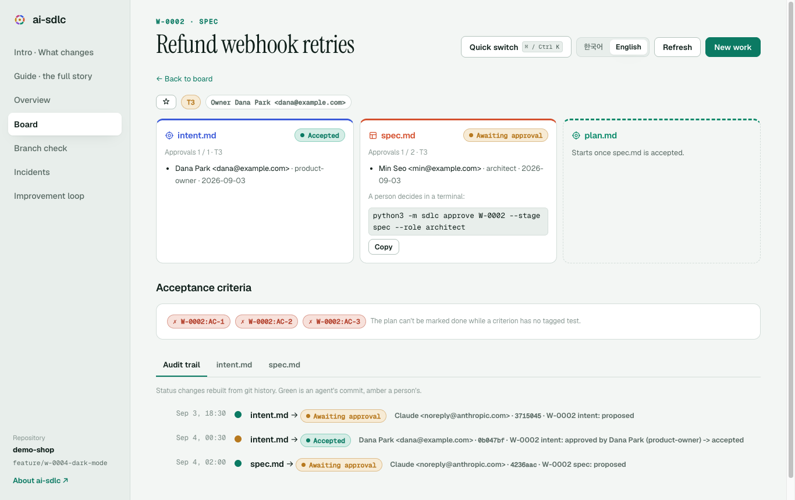
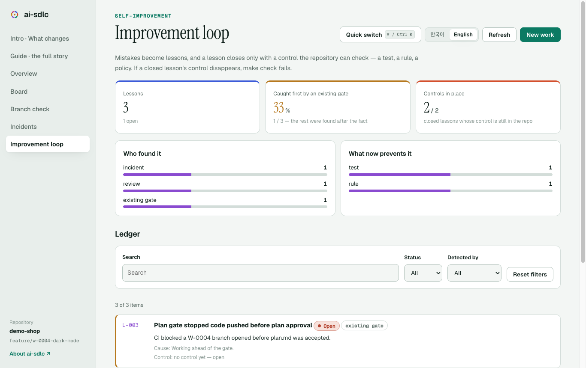

<p align="center"></p>

<h1 align="center">ai-sdlc</h1>

<p align="center"><b>코드가 병목이 아니게 된 뒤의 소프트웨어 개발 수명주기.</b><br>
일은 에이전트가, 결정은 사람이, 규칙은 도구가 맡습니다.</p>

<p align="center"><strong lang="ko">한국어</strong> · <a href="README.en.md" lang="en">English</a></p>

이 README는 한국어와 [English](README.en.md)로 제공됩니다. 두 버전 모두 설치, 사용법,
기능, API, 개발·검증 안내를 포함하며 변경 시 함께 갱신합니다.

---

ai-sdlc는 Anthropic Applied AI의 *AI-native SDLC 플레이북*을 실제로 돌아가게 만든 참조 구현입니다.
모든 단계는 **Git에 커밋된 아티팩트**로 끝나고, 다음 단계는 그 파일을 읽고 시작합니다. 사람은 **게이트**에서만
판단하고, 정책은 에이전트가 **행동하는 순간**에 Hook과 CI가 집행합니다.

- Python 3.11+ 와 git만 있으면 됩니다. 외부 패키지는 쓰지 않습니다 (아이콘 PNG 생성만 Pillow 선택).
- 구성: CLI(`python3 -m sdlc`) · Claude Code Hook/Skill/서브에이전트 · GitHub Actions · 로컬 웹 앱 · 소개 사이트.
- Python 단위 테스트·아티팩트·교훈 검증 (`make check`), 별도 브라우저 회귀 검증.

## 목차

1. [왜 필요한가](#왜-필요한가)
2. [핵심 개념](#핵심-개념)
3. [빠른 시작](#빠른-시작)
4. [작업 한 건의 흐름](#작업-한-건의-흐름)
5. [CLI 레퍼런스](#cli-레퍼런스)
6. [아티팩트 형식](#아티팩트-형식)
7. [거버넌스: 위험 등급 · Hook · 승인](#거버넌스-위험-등급--hook--승인)
8. [자기 개선 루프](#자기-개선-루프)
9. [웹 앱](#웹-앱)
10. [CI/CD 워크플로](#cicd-워크플로)
11. [12개 플레이와 구현](#12개-플레이와-구현)
12. [다른 저장소에 도입하기](#다른-저장소에-도입하기)
13. [저장소 구조](#저장소-구조)
14. [개발](#개발)
15. [알려진 한계](#알려진-한계)
16. [문서](#문서)

---

## 왜 필요한가

에이전트가 빌드를 몇 주에서 몇 시간으로 줄였습니다. 그런데 그 앞뒤의 계획·리뷰·배포가 예전 속도 그대로면 전체
사이클은 빨라지지 않습니다. 세 가지가 동시에 일어납니다.

| 현상 | 결과 |
|---|---|
| 병목이 빌드 양옆(계획·리뷰·배포)으로 이동 | 줄어든 시간이 리뷰 큐와 위원회 일정에 흡수된다 |
| 모든 줄을 사람이 읽는 통제가 현실과 어긋남 | 큐가 쌓이거나, 덜 검토된 채 배포된다 |
| 예외가 주간·월간 위원회로 라우팅 | 거버넌스 비용이 에이전트 산출량에 비례해 커진다 |

실제 저장소에서 잰 예: Claude와 함께 만든 `lls-kit`은 병합된 PR 25건이 **열림→병합 중앙값 10초**,
**리뷰 0건**이었고, ai-sdlc 정책을 재생하면 그중 18건이 사람이 판단해야 하는 T3였습니다.
([측정 방법과 한계](docs/adoption/lls-kit.md))

## 핵심 개념

```
intent.md ──수락──▶ spec.md ──승인──▶ plan.md ──승인──▶ 코드 + 테스트 ──▶ PR ──병합──▶ 릴리스
    ▲                                                                                    │
    └────── incident record ◀── control band 이탈 ◀── 운영 지표 ◀────────────────────────┘
```

| 개념 | 뜻 |
|---|---|
| **아티팩트 체인** | 단계마다 한 파일(`intent.md` → `spec.md` → `plan.md` → diff+tests → PR → incident)을 커밋한다. 커밋 체인이 곧 감사 기록이다. |
| **사람의 게이트** | `proposed` → `accepted`는 사람만 바꾼다. 에이전트 ID로는 승인이 기록되지 않는다. T3 명세·계획은 2명이 필요하다. |
| **행동 시점 집행** | Claude Code Hook이 보호 경로 쓰기, 승인 위조, 등급 하향, 위험 명령을 **실행 전에** 막는다. |
| **위험 등급 T0–T3** | 변경된 경로로 결정적으로 계산된다. 사람 리뷰의 양을 정하고, 에이전트는 올릴 수만 있다. |
| **폐루프** | 운영 지표가 control band를 벗어나면 incident와 새 `intent.md`가 열린다. 사람이 수락하면 다시 Plan이다. |

## 빠른 시작

```bash
git clone https://github.com/kos2001/ai-sdlc.git && cd ai-sdlc
make check                                           # 단위 테스트 + 아티팩트·교훈 검증

# 모든 상태가 들어 있는 예시 저장소(샘플 데이터)로 웹 앱 보기
python3 -m sdlc demo /tmp/demo-shop
python3 -m sdlc --root /tmp/demo-shop serve          # → http://127.0.0.1:8791/
```

자기 저장소에서 쓰려면 [다른 저장소에 도입하기](#다른-저장소에-도입하기)를 보세요.

## 작업 한 건의 흐름

| # | 단계 | 누가 | 명령 / 동작 | 결과 |
|---|---|---|---|---|
| 1 | Plan | 에이전트 | `sdlc new "EU 결제 지연" --tier T2` → 근거·문제 작성 → `sdlc submit W-0142 --stage intent` | `intent.md` proposed |
| 2 | 게이트 | **제품 오너** | `sdlc approve W-0142 --stage intent --role product-owner` | intent accepted |
| 3 | Design | 에이전트 | `sdlc stage W-0142 spec` → 요구사항·설계·`AC-n` 작성 → `submit` | `spec.md` proposed |
| 4 | 게이트 | **아키텍트** (T3는 2명) | `sdlc approve W-0142 --stage spec --role architect` | spec accepted |
| 5 | Build(계획) | 에이전트 | `sdlc stage W-0142 plan` → 체크리스트·테스트 전략·롤아웃·control band → `submit` | `plan.md` proposed |
| 6 | 게이트 | **테크 리드** | `sdlc approve W-0142 --stage plan --role tech-lead` | 이제부터 코드 가능 |
| 7 | Build·Test | 에이전트 | 테스트에 `W-0142:AC-1` 태그, 계획 단계 `- [x]`, `sdlc trace W-0142 --strict`, `make check` | PR |
| 8 | Deploy | CI + 등급만큼의 사람 | `risk` · `plan-gate` · `eval-guard` · `transitions` · 리뷰어 서브에이전트 | 병합, release record |
| 9 | 완료 | 테크 리드 | `sdlc done W-0142 --stage plan` (모든 AC가 추적돼야 가능) | plan done |
| 10 | Maintain | 도구 + 사람 | `sdlc bands open --metrics m.json` → incident + 후속 intent | 다시 1로 |

> 에이전트는 `submit`(draft → proposed)까지만 합니다. `approve`는 Hook이 에이전트에게서 막고, 웹 앱에도 승인
> 버튼이 없습니다. 사람이 자기 터미널에서 실행합니다.

## CLI 레퍼런스

모든 명령은 `python3 -m sdlc [--root <저장소>] <명령>` 형태이며, 위반이 있으면 0이 아닌 코드로 끝납니다
(Hook과 CI가 그대로 쓸 수 있도록).

**아티팩트**

| 명령 | 하는 일 |
|---|---|
| `new <title> [--owner O] [--tier T0..T3]` | `work/<연도>/W-NNNN-<slug>/intent.md` 초안 생성 |
| `stage <W-id> spec\|plan` | 이전 단계가 있어야 다음 초안 생성 (id·등급 복사) |
| `submit <path \| W-id --stage S>` | draft → proposed. 제안 상태로 검증을 통과할 때만 저장 |
| `approve … --role R [--by 이름]` | 사람의 승인 기록. 필요한 수가 차면 accepted. 에이전트 ID 거부 |
| `reject … --reason 이유` | proposed → rejected |
| `done …` | accepted → done. 계획 체크박스와 AC 추적이 모두 끝나야 함 |
| `validate [--changed]` | 모든 아티팩트의 스키마·체인·승인 규칙 검사 |
| `trace [W-id] [--json] [--strict]` | 수락 기준(AC) → 태그된 테스트 커버리지 |

**게이트 (CI가 PR에서 실행)**

| 명령 | 하는 일 |
|---|---|
| `transitions --base REF` | 불법 상태 전이, 승인 변경·삭제, 등급 하향, 아티팩트 삭제 차단 |
| `risk [--base REF] [--floor T] [--json] [paths…]` | 경로 규칙으로 위험 등급과 필요한 사람 리뷰 수 계산 |
| `plan-gate [--base REF] [--refs 브랜치 PR제목…]` | T0가 아닌 변경은 accepted `plan.md`가 있는 W-NNNN 필요 |
| `eval-guard [--base REF]` | 테스트·eval 삭제, 테스트 정의·AC 태그 제거, skip 추가 탐지 |

**루프와 운영**

| 명령 | 하는 일 |
|---|---|
| `events --base REF [--json]` | 상태 변화 → 다음 플레이와 Skill (오케스트레이터 입력) |
| `bands check\|open --metrics m.json` | control band 판정 / 위반 시 incident + proposed intent 생성 (중복 방지) |
| `feedback comments.json… [--out 파일]` | `[rule]`·`[bug]`·`[false-positive]` 리뷰 코멘트를 규칙·eval 후보로 |
| `lessons status\|add\|close\|check` | 자기 개선 루프: 실수 → 교훈 → 저장소가 확인하는 통제 ([아래](#자기-개선-루프)) |
| `release-record --base REF [--pr N] [--approver 이름…]` | 등급·작업 항목·사람 승인자·에이전트 공동 작성자 기록 |
| `hook pre-tool-use\|post-tool-use\|stop\|user-prompt-submit` | Claude Code Hook 핸들러 (stdin JSON) |
| `serve [--port 8791]` | 로컬 웹 앱 (127.0.0.1 전용) |
| `demo <dir>` | 모든 상태를 거치는 예시 저장소 생성 |

## 아티팩트 형식

Markdown + YAML frontmatter(의도적으로 좁은 부분집합). 템플릿은 [`templates/`](templates/).

```yaml
---
id: W-0142
type: intent            # intent | spec | plan | incident
status: proposed        # draft → proposed → accepted → done  (rejected, superseded)
owner: "Dana Park <dana@example.com>"
sources:                # proposed 이상은 근거 1개 이상 필수
  - kind: ticket
    ref: SUP-8812
risk_tier: T2           # T0..T3, 올릴 수만 있음
origin: human           # human | maintain-loop
approvals: []           # 사람만, 추가만 가능
---
```

| 파일 | 필수 섹션 / 규칙 |
|---|---|
| `intent.md` | `## Problem`, `## Desired outcome` 비어 있으면 제출 불가 |
| `spec.md` | intent가 accepted여야 제출. `## Acceptance criteria`에 `AC-1…` |
| `plan.md` | spec이 accepted여야 제출. `## Steps`에 `- [ ]` 체크리스트. done은 모든 체크 + 모든 AC 추적 |
| `incidents/<연도>/INC-*.md` | open → diagnosed → closed. closed는 후속 intent나 resolution 필요 |

## 거버넌스: 위험 등급 · Hook · 승인

**위험 등급** — [`policy/risk-tiers.json`](policy/risk-tiers.json). 가장 높은 규칙이 이깁니다.

| 등급 | 예 | 사람 리뷰 | 릴리스 |
|---|---|---|---|
| T0 | 문서, `work/**` | 0 (사후 샘플 감사) | 자동 |
| T1 | 일반 기능 코드, 테스트 | 0 (사후 샘플 감사) | 자동 + canary |
| T2 | 마이그레이션, 공개 API, 의존성, `CLAUDE.md`·Skill | 1 (findings 중심) | 자동 + canary |
| T3 | 인증·결제·규제 데이터·IaC 권한, 통제 파일 자체 | 2 (라인 단위) | `production` 환경 승인 |

**Hook** — [`.claude/settings.json`](.claude/settings.json) → `sdlc/hooks.py`, 규칙은 [`policy/guard.json`](policy/guard.json).

| 이벤트 | 동작 |
|---|---|
| PreToolUse | 위험 명령(force push, main 직접 push, `--no-verify`, `sdlc approve`, `curl \| sh`, `terraform apply`, `gh pr merge` …) 차단, 보호 경로(`policy/**`, `.claude/settings.json`, `.github/workflows/**`, `sdlc/hooks.py` …) 쓰기 차단, 아티팩트에서 승인 기록·게이트 상태 변경·등급 하향 차단 |
| PostToolUse | 방금 편집한 아티팩트를 검증해 문제를 에이전트에게 돌려줌 |
| Stop | 바뀐 아티팩트가 유효하지 않으면 종료를 막음 (한 번만) |
| UserPromptSubmit | 브랜치 이름의 W-NNNN으로 현재 작업 상태를 주입 |

Hook은 입력이 깨졌거나 정책 파일이 잘못되면 **막는 쪽으로** 실패합니다.

**승인 규칙** — 사람 ID만(`claude`, `anthropic`, `[bot]`, `github-actions` 거부), 같은 사람 중복 불가,
추가만 가능(`transitions`가 PR에서 검사), T3 spec/plan은 2건.

## 자기 개선 루프

에이전트는 실수를 합니다. 중요한 것은 같은 실수가 **다시는 조용히 들어오지 않게** 하는 것입니다.

```
실수가 잡힘 ──▶ lessons add (교훈, 열림) ──▶ 통제 작성 ──▶ lessons close (통제가 있어야 닫힘)
     ▲                                                                     │
     └──── make check / CI: 닫힌 교훈의 통제가 사라지면 실패 ◀──────────────┘
```

| 요소 | 내용 |
|---|---|
| 원장 | [`lessons/ledger.json`](lessons/ledger.json) — 교훈마다 누가 찾았나(`gate`·`test`·`review`·`human`·`measurement`·`incident`), 무슨 일, 근본 원인, **기존 게이트가 먼저 잡았는가**, 통제 |
| 통제 | `path::needle` — 저장소에 남아 있어야 하는 파일과 문자열. 종류: `test`, `rule`(CLAUDE.md에 자동 기록), `policy`, `eval`, `doc` |
| 강제 | `sdlc lessons check`가 `make check`에 포함 — 닫힌 교훈의 통제(테스트 이름, 규칙 문장)가 사라지면 CI 실패. 30일 넘게 열린 교훈은 경고 |
| 측정 | `sdlc lessons status` · 웹 앱 **개선 루프** 화면 — 기존 게이트가 먼저 잡은 비율(예방률), 발견 주체, 통제 종류, 살아 있는 통제 수 |
| 에이전트 | [`retrospect`](.claude/skills/retrospect/SKILL.md) Skill — 실수가 잡히면 수정과 같은 변경에서 기록하고 닫는다 |

```bash
python3 -m sdlc lessons add "eval-guard가 check() 삭제를 못 봤다" --detected-by measurement \
  --what "lls-kit 테스트는 check(...) 형식이라 삭제가 통과했다" --cause "테스트 정의 패턴이 하드코딩"
python3 -m sdlc lessons close L-012 --kind test --ref "tests/test_gates.py::class EvalGuardHouseStyleTest"
python3 -m sdlc lessons close L-013 --kind rule --rule "데이터에서 패턴을 말하기 전에 전체를 다시 잰다."
python3 -m sdlc lessons status
```

이 저장소의 원장은 만드는 동안 실제로 한 실수 11건으로 시작했습니다. 당시 9건은 테스트나 규칙으로 닫혔고,
2건은 열려 있었습니다. **초기 11건 중 기존 게이트가 먼저 잡은 것은 2건(18%)** — 나머지는 사람·리뷰·측정이
사후에 찾았습니다. 현재 수치와 추가 교훈은 `python3 -m sdlc lessons status`와 개선 루프 화면에서 확인합니다.

## 웹 앱

```bash
python3 -m sdlc --root <저장소> serve        # http://127.0.0.1:8791/  (한국어 / English)
```

### 화면 (샘플 저장소 `python3 -m sdlc demo` 기준)

| | |
|---|---|
|  |  |
| 개요: 진행 중 작업, 사람을 기다리는 게이트, 게이트 대기 중앙값, 승인 명령 복사 | 보드: 단계별 칸반, 검색·필터·정렬, 저장된 보기, 즐겨찾기 |
|  |  |
| 작업 항목: intent → spec → plan 체인, 승인 현황, AC 추적, git 기반 감사 추적 | 개선 루프: 교훈 장부, 기존 게이트가 먼저 잡은 비율, 유지 중인 통제 |

| 화면 | 내용 |
|---|---|
| 소개 | 전통 SDLC와 무엇이 다른가 — 한눈에 보는 차이, 단계별 변화, 누가 무엇을, 이 저장소의 실데이터 카드, FAQ |
| 가이드 | 전체 이야기 (`web/index.html`) 를 앱 안에서 |
| 개요 | 진행 중인 작업, 사람을 기다리는 게이트, 게이트 대기 중앙값(git), AC 추적, 열린 인시던트, 복사할 승인 명령 |
| 작업 보드 | 칸반/목록, 필드 검색·필터·정렬, 이름 있는 보기 저장·갱신·공유, 즐겨찾기·최근 작업, 읽기 전용 미리보기 |
| 작업 상세 | 체인·감사 기록·AC 추적, 키보드 상세 탭, 초안 본문·근거 편집, Markdown 서식 도구와 미리보기·저장·제출 |
| 브랜치 점검 | 비교 기준 ref 선택, 위험 등급과 원인 파일, CI와 같은 게이트, 오류 재시도 |
| 인시던트 | control band 이탈과 후속 의도, 검색·상태 필터 |
| 개선 루프 | 교훈·예방률·통제와 검색·상태·발견 주체 필터 |

개요의 작업 수와 단계 링크를 클릭하면 해당 조건의 보드로 이동합니다. 새 작업을 만들면
의도 편집 탭이 열립니다. 본문과 근거를 작성하고 **변경 저장** 후 **제출**하세요.
상단 **빠른 이동** 또는 **Ctrl/⌘ K**로 작업과 화면을 검색하고 방향키·Enter로 이동합니다.
즐겨찾기·최근 작업이 먼저 나타나며, 저장된 보기 이름으로도 검색할 수 있습니다.
보드의 **새 보기 저장**은 검색·필터·정렬·보기 방식을 보관합니다. 조건 변경 후에는
**현재 조건 저장**으로 갱신합니다. **조건 링크 복사**는 개인 보기 ID 없이 실제 조건을 공유합니다.
작업의 별표는 개인 즐겨찾기를 토글합니다. 개인 보기·즐겨찾기·최근 ID는 같은 브라우저와
저장소에만 보관되며, 저장소를 다른 경로로 이동하면 별도 설정 공간으로 시작합니다.
브라우저 저장이 차단되거나 가득 차면 안내와 함께 현재 탭에서만 유지합니다.
검색 예: `stage:spec tier:T3 owner:"Dana Park"`, `stage:spec,done -tier:T1`, `is:favorite`.
필드 조건은 AND, 쉼표 값은 OR로 묶입니다. `is:waiting`, `is:issues`, `is:untraced`, `is:recent`, `is:draft`도 지원하며
검색식 도움말에서 확인할 수 있습니다. 입력 오류는 결과 위에 표시합니다.
보드의 **미리보기**는 읽기 패널을 열고, Escape로 닫으면 같은 위치로 돌아옵니다.
보드 조건은 URL에 보존하며 상세 화면에서 돌아오면 복원합니다.
초안에서 텍스트를 선택해 제목·굵게·목록·체크리스트·코드 서식을 적용하고 **Ctrl/⌘ S**로 저장할 수 있습니다.
편집 중 탭·언어 전환과 앱 내 새로고침은 입력을 유지하며, 화면 이탈에는 확인을 요청합니다.
다른 편집기에서 파일이 바뀌면 저장을 거절하고 입력을 유지합니다. 최신 파일 불러오기는
확인 후 입력을 버립니다. 제출된 아티팩트는 읽기 전용이며 승인은 기존 사람 CLI로 합니다.

**API** (모두 JSON)

| 메서드 | 경로 | 설명 |
|---|---|---|
| GET | `/api/overview` | 요약 지표, 승인 대기 목록, 개인 설정 격리용 workspace_id(저장소 경로의 SHA-256) |
| GET | `/api/work`, `/api/work/W-NNNN` | 작업 목록 / 상세(본문·감사 기록 포함) |
| GET | `/api/branch?base=REF` | 위험 등급, 게이트 결과, 이벤트 |
| GET | `/api/incidents` | 인시던트 |
| GET | `/api/lessons` | 교훈 원장과 측정값 |
| POST | `/api/work` | 의도 초안 생성 `{title, owner, tier}` |
| POST | `/api/work/W-NNNN/draft` | 초안 본문 저장 `{stage, body, revision, sources?}`. sources는 intent만. revision은 상세 응답에 포함. 오래된 revision·비초안은 409, 잘못된 입력은 400 |
| POST | `/api/work/W-NNNN/stage` | 다음 단계 초안 `{stage}` |
| POST | `/api/work/W-NNNN/submit` | 제출 `{stage}` — 게이트 위반은 409 |

**보안 모델**: 127.0.0.1에만 바인딩, Host 헤더가 루프백이 아니면 403(DNS rebinding 차단), 쓰기는
`Content-Type: application/json` + `X-SDLC: 1` 헤더 필수, 정적 파일은 앱 폴더 밖으로 나가지 않음.
**승인 엔드포인트는 일부러 없습니다** — 로컬의 어떤 프로세스(에이전트 포함)든 HTTP를 부를 수 있기 때문입니다.
초안 편집은 본문·근거만 허용하며 승인·상태·등급·담당자 등 메타데이터는 보존합니다.
HTTP 쓰기는 서버에서 직렬화하고 파일은 원자적으로 교체합니다. 외부 편집기는 revision으로
확인하지만, 외부 프로세스와의 완전한 트랜잭션 잠금은 제공하지 않습니다.

## CI/CD 워크플로

| 워크플로 | 언제 | 하는 일 |
|---|---|---|
| [`ci.yml`](.github/workflows/ci.yml) | PR, 리뷰, main push | `make check`, transitions, plan-gate, eval-guard(라벨 `eval-change-approved`로 예외), 위험 등급 라벨과 필요한 사람 승인 수 검사 |
| [`pr-review.yml`](.github/workflows/pr-review.yml) | PR | `review-pr` Skill로 서브에이전트 리뷰, findings 게시 |
| [`advance.yml`](.github/workflows/advance.yml) | main에 `work/**` 변경 | `sdlc events` → 다음 플레이 Skill 실행, PR 생성 |
| [`control-band.yml`](.github/workflows/control-band.yml) | `repository_dispatch` | 지표 → incident + intent + 진단 PR |
| [`feedback.yml`](.github/workflows/feedback.yml) | 매주 월요일 | 태그된 리뷰 코멘트 → CLAUDE.md 규칙·회귀 eval PR |
| [`release.yml`](.github/workflows/release.yml) | main push | release record, T3는 `production` 환경 승인 뒤 배포 |

설정할 것: 시크릿 `ANTHROPIC_API_KEY`, 변수 `DEPLOY_COMMAND`, `production` 환경의 필수 리뷰어,
[`.github/CODEOWNERS`](.github/CODEOWNERS)의 팀 이름, 브랜치 보호의 "Require review from Code Owners".

## 12개 플레이와 구현

| Play | 구현 |
|---|---|
| 1 Capture intent | `sdlc new/submit`, `capture-intent` Skill |
| 2 CLAUDE.md | 루트 [`CLAUDE.md`](CLAUDE.md) |
| 3 Skills | [`.claude/skills/`](.claude/skills) 8종 |
| 4 Feedback loop | `sdlc feedback`, `apply-feedback`, `feedback.yml`, 자기 개선 루프(`sdlc lessons`, `retrospect`) |
| 5 Hooks | `sdlc/hooks.py`, `policy/guard.json` |
| 6 Plan mode | `plan-from-spec`, `sdlc plan-gate` |
| 7 Subagents | [`.claude/agents/`](.claude/agents) — spec-conformance · security · test · perf (읽기 전용) |
| 8 Evals | `sdlc trace`, `sdlc eval-guard` |
| 9 Requirements & design | `write-spec`, `advance.yml` |
| 10 PR review | `review-pr`, [`REVIEW.md`](REVIEW.md), `ci.yml` |
| 11 CI/CD | `ci.yml`, `release.yml`, `sdlc release-record` |
| 12 Closing the loop | `sdlc bands`, `incident-to-intent`, `control-band.yml` |

## 다른 저장소에 도입하기

1. `sdlc/`, `templates/`, `policy/`를 복사한다 (`sdlc/`는 외부 패키지 없음).
2. `policy/risk-tiers.json`의 경로 규칙을 그 저장소에 맞게 고친다. 테스트 스타일이 `def test_`가 아니면
   `policy/eval-guard.json`에 `{"test_definitions": ["^\\s*check\\("]}`처럼 정의 패턴을 추가한다.
3. `.claude/settings.json`으로 Hook을 켜고, `CLAUDE.md`에 아티팩트 체인 규칙을 한 절 넣는다.
4. 새 작업부터 W-NNNN을 쓴다. 기존 이력은 소급하지 않는다.
5. CI를 붙인다.

실제 사례: [`docs/adoption/lls-kit.md`](docs/adoption/lls-kit.md) — 3GPP 시뮬레이터 저장소에 재생해 본 결과,
조정한 점(1인 소유 저장소, 12KB 파일 제한, `check(...)` 테스트 스타일), 도입 순서.

## 저장소 구조

```
sdlc/                 CLI와 라이브러리 (표준 라이브러리만, 파일당 12KB 이하)
  artifacts.py        스키마, 상태 기계, 검증 규칙        frontmatter.py  YAML 부분집합 파서
  workitems.py        new/stage/submit/approve/done       trace.py        AC → 테스트 추적
  risk.py · policy.py 위험 등급, 경로 glob                gates.py        plan-gate, eval-guard
  hooks.py            Claude Code Hook 핸들러              events.py       상태 변화 → 다음 플레이
  bands.py            control band → incident + intent    release.py      release record
  feedback.py         리뷰 코멘트 → 규칙·eval 후보         api.py · server.py  웹 앱 백엔드
  lessons.py          자기 개선 루프 (교훈 → 통제)
  demo.py             예시 저장소 생성                     cli.py · cli_ops.py 명령 정의
  webapp/             웹 앱 프런트엔드 (빌드 단계 없음, 한/영)
templates/            intent · spec · plan · incident 템플릿
policy/               guard.json (Hook 규칙), risk-tiers.json (등급)
.claude/              settings.json (Hook), skills/ 8종, agents/ 4종
.github/workflows/    ci · pr-review · advance · control-band · feedback · release
web/index.html        소개 사이트 (한/영, 앱 안의 가이드로도 쓰임) · web/icons/ 아이콘
bands/                control band 정의 예시
lessons/ledger.json   교훈 원장
scripts/make_icons.py 아이콘 생성
docs/                 design/ 설계서 · adoption/ 도입 사례 · patches/ 적용 대기 패치
tests/                Python unittest + frontend.js · discovery.js 브라우저 회귀 검증
```

## 개발

```bash
make check                                  # 단위 테스트 + 아티팩트 검증 + 교훈 통제 (CI와 동일)
python3 -m unittest tests.test_server -v    # 특정 모듈만
python3 scripts/make_icons.py [--png]       # 아이콘 재생성 (PNG는 Pillow 필요)
```

브라우저 검증은 Node.js와 별도로 설치한 Playwright/Chromium을 사용하며 제품 실행에는
필요하지 않습니다. 임시 demo 저장소를 생성해 검증하고 종료 시 정리합니다.

```bash
export SDLC_PLAYWRIGHT=/absolute/path/to/node_modules/playwright
# 설치된 Chromium을 사용하려면 선택적으로 지정
export SDLC_CHROMIUM=/absolute/path/to/chromium
python3 scripts/check_frontend.py
```

보드 탐색, 보기 저장·공유, 즐겨찾기·최근 작업, 필드 검색, 브라우저 저장 실패·저장소 격리,
생성→편집→저장→제출, 동시·실패·지연 응답, 저장 충돌, 키보드 탭과
375px/데스크톱 × 한국어/영어 × 밝은/어두운 화면을 검증합니다.
스크린샷은 기본 `/private/tmp/ai-sdlc-frontend-qa`에 저장하며 `SDLC_SCREENSHOTS`로 변경할 수 있습니다.

- 파이썬은 표준 라이브러리만, 테스트는 `unittest`. 명령은 위반 시 0이 아닌 종료 코드.
- `sdlc/` 파일은 12KB 이하로 유지합니다 (이 패키지를 복사해 쓰는 저장소의 입력 크기 게이트 때문).
- 에이전트 작업 규칙은 [`CLAUDE.md`](CLAUDE.md), 리뷰 기준은 [`REVIEW.md`](REVIEW.md).
- 커밋은 기능 브랜치에서, `main`으로는 PR로.

## 알려진 한계

- **Hook의 셸 쓰기 탐지가 과민합니다.** 보호 경로를 *언급만* 해도 막는 경우가 있습니다. 실제 쓰기 대상만
  판정하는 수정안과 테스트가 [`docs/patches/0001-…`](docs/patches/0001-hook-target-aware-shell-writes.patch)에
  있습니다. 보호 파일이라 에이전트가 적용할 수 없고, 사람이 `git apply`로 적용해야 합니다.
- 셸 쓰기 탐지는 휴리스틱입니다 (`cd` 뒤 상대 경로, `python -c` 안의 쓰기는 못 잡음). 최종 방어선은 CODEOWNERS와 CI입니다.
- `approvals`는 frontmatter에 있어 사람이 손으로 위조할 수 있습니다. CODEOWNERS 필수 리뷰와 PR 승인 기록으로 보완합니다.
- `ci.yml`은 승인 **수**만 셉니다. 승인자가 코드 오너인지는 브랜치 보호 설정으로 강제해야 합니다.
- 1인 소유 저장소를 위한 "단독 소유자 모드"(GitHub 자기 승인 불가 대응)는 아직 없습니다.
- `pr-review`, `advance`, `control-band`, `feedback` 워크플로는 실제 GitHub에서 아직 실행해 보지 않았습니다 (`ci`, `release`는 통과).

## 문서

| 문서 | 내용 |
|---|---|
| [한국어 README](README.md) · [English README](README.en.md) | 설치·사용·기능·API·개발 안내 (한국어 / English) |
| [`docs/design/ai-native-sdlc-design.md`](docs/design/ai-native-sdlc-design.md) | 설계서: 원칙, 아키텍처, 아티팩트 사양, 12개 플레이, 거버넌스, 로드맵, 구현 현황 |
| [`docs/adoption/lls-kit.md`](docs/adoption/lls-kit.md) | 실제 저장소 도입 검토와 측정 |
| [`CLAUDE.md`](CLAUDE.md) · [`REVIEW.md`](REVIEW.md) | 에이전트 운영 규칙 · 리뷰 정책 |
| `web/index.html` | 소개 사이트 (`serve` 후 `/about`, 앱의 가이드 화면) |
