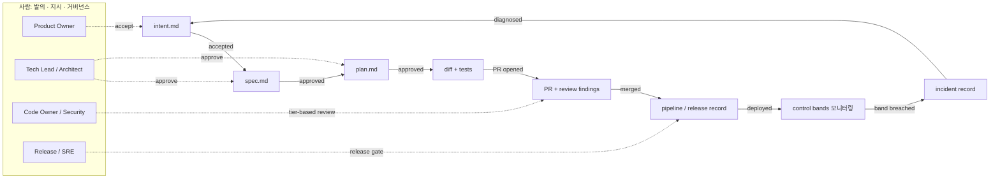
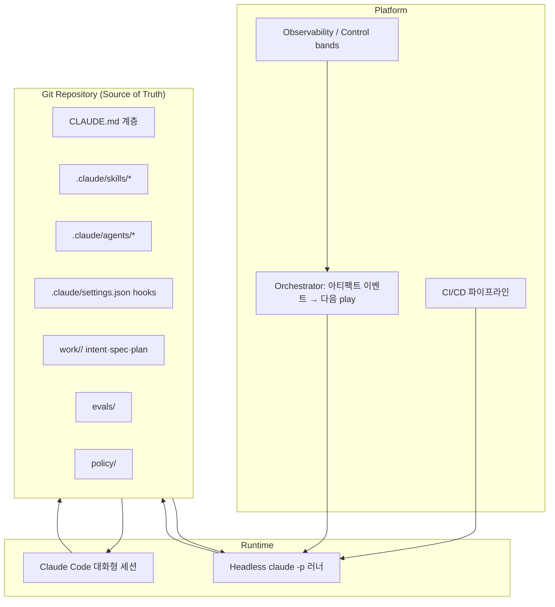
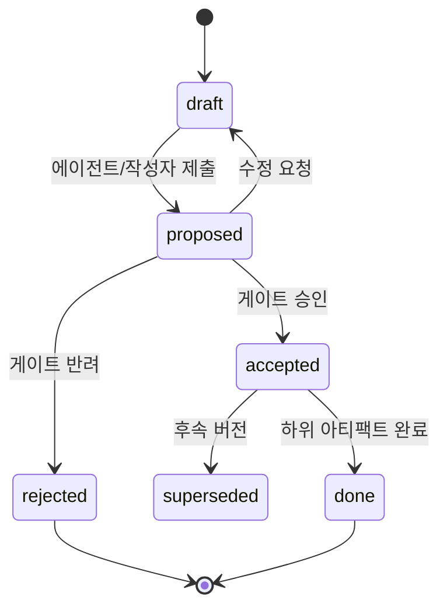
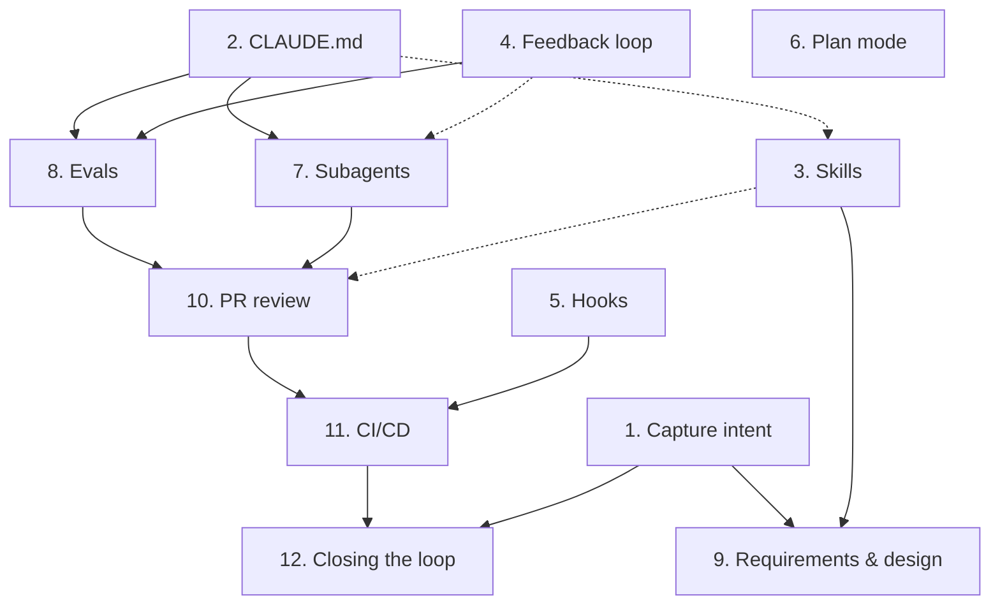

# AI-Native SDLC 설계서

| 항목 | 내용 |
|---|---|
| 문서 상태 | Draft v0.1 |
| 작성일 | 2026-09-18 |
| 범위 | Plan → Design → Build → Test → Deploy → Maintain 전 단계 |
| 기반 | Anthropic Applied AI "AI-native SDLC" 플레이북 (12 plays) |
| 도구 전제 | Claude Code (CLAUDE.md, Skills, Subagents, Hooks, Plan mode, headless `claude -p`), Git 호스팅(GitHub 기준), CI/CD, 관측(Observability) 스택 |

---

## 1. 배경과 문제 정의

### 1.1 병목의 이동

기존 SDLC는 "코드를 작성하는 것이 가장 비싸다"는 전제로 설계되었다. PRD, 추정 회의, 보안 리뷰 위원회는 수주~수개월의 개발 작업 전에 정렬을 강제하기 위한 장치였다. 에이전트가 Build 단계를 수분~수시간으로 압축하면서 다음이 발생한다.

| 현상 | 결과 |
|---|---|
| 병목이 Build 양옆(Plan, Review/Test, Deploy)으로 이동 | 사이클 타임 단축분이 대기열로 흡수됨 |
| 사람이 모든 라인을 리뷰하는 통제가 현실과 불일치 | 리뷰 큐 적체 또는 리뷰 없이 배포 — 규제 조직은 둘 다 수용 불가 |
| 예외 처리가 주간/월간 위원회로 라우팅 | 거버넌스 비용이 에이전트 산출량에 비례해 증가 |

### 1.2 설계가 풀어야 할 질문

1. 단계 간 핸드오프를 **문서·티켓·사인오프**에서 **커밋된 아티팩트 + 자동 트리거**로 바꿀 수 있는가?
2. 통제 목표(책임성, 추적성, 보안)는 유지하면서 **집행 방식**을 사람 중심에서 **에이전트가 행동하는 시점의 자동 집행**으로 옮길 수 있는가?
3. 사람의 주의(attention)를 **판단이 필요한 게이트**에만 집중시킬 수 있는가?

---

## 2. 목표와 비목표

### 2.1 목표

- **G1. 아티팩트 체인**: 모든 단계는 Git에 커밋된 아티팩트로 끝나고, 다음 단계는 그 아티팩트를 읽고 시작한다.
- **G2. 루프화**: 선형 흐름을 운영 신호 → 새 intent로 되돌아오는 폐루프로 전환한다.
- **G3. 집행 시점 거버넌스**: 정책은 Hooks·CI 게이트로 에이전트 행동 시점에 집행된다.
- **G4. 위험 기반 사람 리뷰**: 사람 리뷰는 규제·핵심 코드와 에이전트가 플래그한 항목에 한정한다.
- **G5. 감사 추적**: "누가 무엇을 요청했고, 에이전트가 무엇을 만들었고, 누가 승인했는가"가 커밋 체인만으로 재구성된다.
- **G6. 모듈형 도입**: 12개 플레이를 의존성 그래프에 따라 독립적으로 도입할 수 있다.

### 2.2 비목표

- 사람의 책임(accountability) 제거 — 판단이 필요한 모든 결정은 사람에게 귀속된다.
- 특정 이슈 트래커/CI 벤더 종속 — 인터페이스(이벤트, 아티팩트 스키마)만 정의한다.
- 1차 릴리스에서의 완전 자동 루프 — 초기에는 각 단계를 사람이 프롬프트로 구동한다(§11 로드맵).

---

## 3. 설계 원칙

| # | 원칙 | 의미 |
|---|---|---|
| P1 | **Artifact is the interface** | 단계 간 계약은 회의가 아니라 파일(`intent.md`, `spec.md`, `plan.md`, diff+tests, PR, incident record)이다. |
| P2 | **Human-readable, machine-actionable** | 초기 단계 아티팩트는 Markdown + YAML frontmatter. 제품 오너와 에이전트가 같은 파일을 읽고 행동한다. |
| P3 | **Same control objective, new enforcement** | 통제 목표는 유지, 집행 수단을 Hooks·Evals·CI 정책으로 대체한다. |
| P4 | **Gates, not stages** | 사람은 단계를 처음부터 수행하지 않고, 게이트에서 에이전트가 플래그한 것을 검토한다. |
| P5 | **Knowledge as code** | 조직 지식은 버전 관리되는 `CLAUDE.md`와 Skills로 유지한다. 사후 문서화는 없다. |
| P6 | **Risk-tiered attention** | 리뷰 강도는 변경의 위험 등급(§8.1)으로 결정한다. |
| P7 | **Commit chain = audit trail** | 별도 감사 시스템을 만들지 않고 Git 이력과 PR 기록을 감사 원장으로 사용한다. |

---

## 4. 전체 아키텍처

### 4.1 루프 개요



### 4.2 단계별 입력/출력/게이트

| 단계 | 입력 아티팩트 | 에이전트 작업 | 출력 아티팩트 | 사람 게이트 | 다음 트리거 |
|---|---|---|---|---|---|
| Plan | 소스 신호(고객 피드백, 티켓, 인시던트, 로그) | 페인포인트 종합, 의도 추출 | `intent.md` | PO가 `status: accepted` | intent 수락 커밋 |
| Design | `intent.md` + 표준 Skills | 요구사항·설계를 한 세션에서 압축 | `spec.md` | 아키텍트 승인 | spec 승인 커밋 |
| Build (계획) | `spec.md` | Plan mode로 구현 계획 수립 | `plan.md` | Tech Lead 승인 | plan 승인 커밋 |
| Build (구현) | `plan.md` + `CLAUDE.md` | 테스트·코드 생성, Hooks 집행 | diff + tests | 없음(자동 게이트) | PR 생성 |
| Test | diff | 연속 Evals, 서브에이전트 리뷰 | PR + review findings | 위험 등급별 | PR 머지 |
| Deploy | merged PR | 파이프라인, 정책 검사, 점진 배포 | release record | 등급 T3 이상 릴리스 승인 | 배포 완료 이벤트 |
| Maintain | 운영 신호 | control band 감시, 진단 | incident record → 새 `intent.md` | 인시던트 오너 수락 | 새 intent 커밋 |

### 4.3 구성 요소



- **Orchestrator**: Git 이벤트(커밋, frontmatter 상태 변경, PR 이벤트)와 관측 이벤트(control band 위반)를 받아 해당 play를 headless Claude 실행으로 트리거한다. 초기에는 GitHub Actions 워크플로로 구현하고 별도 서비스는 만들지 않는다.

---

## 5. 아티팩트 사양

### 5.1 공통 규칙

- 위치: `work/<YYYY>/<work-id>/` (예: `work/2026/W-0142-checkout-latency/`)
- 모든 `.md` 아티팩트는 YAML frontmatter를 가진다.
- 상태 변경은 **반드시 커밋**으로 이루어진다. 승인은 frontmatter의 `approvals` 필드 + 해당 커밋의 서명자(또는 PR 승인)로 이중 기록한다.
- 에이전트가 생성한 커밋은 `Co-Authored-By` 트레일러와 `Agent-Run: <run-id>` 트레일러를 포함한다.

### 5.2 상태 머신



### 5.3 `intent.md`

```markdown
---
id: W-0142
type: intent
status: proposed            # draft|proposed|accepted|rejected|superseded|done
owner: "@po-handle"
sources:                    # 에이전트가 종합한 근거 (추적성)
  - kind: ticket
    ref: SUP-8812
  - kind: metric
    ref: "checkout.p95_latency > 1.2s (7d)"
  - kind: incident
    ref: INC-2026-091
risk_tier: T2               # §8.1
origin: human|maintain-loop # 루프에서 생성된 경우 maintain-loop
approvals: []
---

## Problem
누가, 어떤 상황에서, 무엇 때문에 불편한가 (근거 링크 포함)

## Desired outcome
관찰 가능한 결과. 측정 지표와 목표값.

## Constraints
규제, 성능, 호환성, 일정.

## Out of scope

## Open questions
```

### 5.4 `spec.md`

```markdown
---
id: W-0142
type: spec
status: proposed
intent: ./intent.md
skills_applied: [api-design-standard, data-classification]
risk_tier: T2
approvals: []
---

## Requirements        # 번호 붙은 검증 가능 요구사항 (R1, R2 ...)
## Design              # 컴포넌트, 인터페이스, 데이터 흐름
## Acceptance criteria # 각 R에 매핑, evals로 변환 가능해야 함
## Security & compliance notes
## Alternatives considered
```

### 5.5 `plan.md`

```markdown
---
id: W-0142
type: plan
status: proposed
spec: ./spec.md
approvals: []
---

## Steps               # 순서, 병렬 가능 여부, 대상 파일
## Test strategy       # 어떤 테스트/eval이 어떤 AC를 검증하는가
## Rollout             # feature flag, canary, 롤백 조건
## Control bands       # 배포 후 감시할 지표와 임계치 (Maintain 입력)
```

### 5.6 PR과 incident record

- **PR 본문 템플릿**: 연결된 `work-id`, 충족한 R/AC 체크리스트, eval 결과 요약, 서브에이전트 리뷰 findings(심각도·처리 여부), 위험 등급, 필요한 사람 리뷰어.
- **incident record** (`incidents/<YYYY>/INC-*.md`): 위반된 control band, 타임라인, 에이전트 진단(가설·근거), 영향 범위, 연결된 원인 커밋, 생성된 후속 `intent.md` 링크.

---

## 6. 리포지토리 레이아웃

```
.
├── CLAUDE.md                     # 전사/레포 공통 규칙 (빌드, 테스트, 금지사항)
├── services/<svc>/CLAUDE.md      # 서비스별 로컬 규칙 (계층형)
├── .claude/
│   ├── settings.json             # hooks, permissions (팀 공유)
│   ├── skills/
│   │   ├── capture-intent/SKILL.md
│   │   ├── write-spec/SKILL.md
│   │   ├── api-design-standard/SKILL.md
│   │   ├── data-classification/SKILL.md
│   │   └── incident-to-intent/SKILL.md
│   └── agents/
│       ├── security-reviewer.md
│       ├── test-reviewer.md
│       ├── spec-conformance-reviewer.md
│       └── perf-reviewer.md
├── work/<YYYY>/<work-id>/{intent,spec,plan}.md
├── incidents/<YYYY>/INC-*.md
├── evals/
│   ├── suites/<domain>/*.yaml    # AC → eval 케이스
│   └── feedback/                 # 사람 피드백에서 추출한 회귀 케이스
├── policy/
│   ├── risk-tiers.yaml           # 경로·데이터 분류 → 위험 등급
│   ├── codeowners-tiered         # 등급별 필수 리뷰어
│   └── hooks/                    # hook 스크립트 (pre-tool, post-tool, stop)
└── .github/workflows/
    ├── on-intent-accepted.yml
    ├── on-spec-approved.yml
    ├── pr-agentic-review.yml
    ├── deploy.yml
    └── on-control-band-breach.yml
```

---

## 7. 플레이 설계 (12 Plays)

### 7.0 의존성 그래프



실선 = 필수 선행, 점선 = 도움이 되지만 필수 아님.

각 플레이는 **변화 / 선행조건 / 구현 단계 / 거버넌스 / 측정** 5개 항목으로 기술한다.

---

### Play 1. Capture intent — `Plan`

- **변화**: 위원회·워크숍 기반 요구사항 수집 → Claude가 원천 소스(티켓, 고객 피드백, 인시던트, 지표)에서 페인포인트를 직접 종합해 `intent.md` 생성.
- **선행조건**: 없음.
- **구현 단계**
  1. `capture-intent` Skill 작성: 입력 소스 목록, §5.3 템플릿, "근거 없는 주장 금지(모든 Problem 문장은 `sources` 참조)" 규칙.
  2. 소스 접근: 이슈 트래커·지원 티켓·지표 조회는 MCP 서버 또는 읽기 전용 export로 제공(최소 권한).
  3. PO가 세션에서 `/capture-intent <주제>` 실행 → 초안 검토 → `status: accepted`로 커밋.
- **거버넌스**: `accepted` 전환은 `owner`만 가능(CODEOWNERS on `work/**/intent.md`). 고객 PII는 intent에 원문 인용 금지(Hook으로 패턴 검사).
- **측정**: 아이디어→accepted intent 리드타임, intent 반려율, `sources` 없는 intent 비율(목표 0).

### Play 2. CLAUDE.md — `Build`

- **변화**: 사후 문서화 → 버전 관리되는 기계 판독 가능 지식.
- **선행조건**: 없음.
- **구현 단계**
  1. 루트 `CLAUDE.md`: 빌드/테스트 명령, 브랜치·커밋 규칙, 금지 패턴, 아티팩트 체인 규칙(§5).
  2. 서비스별 `CLAUDE.md`: 도메인 용어, 아키텍처 경계, 로컬 테스트 방법.
  3. 규칙 추가 기준: 에이전트가 같은 실수를 2회 이상 하면 `CLAUDE.md`에 반영(Feedback loop와 연결).
  4. 크기 관리: 짧고 명령형으로 유지. 긴 절차는 Skill로 분리.
- **거버넌스**: `CLAUDE.md` 변경은 일반 코드와 동일하게 PR 리뷰. 플랫폼 팀이 루트 파일의 CODEOWNER.
- **측정**: 세션당 사람 교정 횟수, 동일 유형 리뷰 지적 재발률.

### Play 3. Skills — `Design`

- **변화**: 표준·가이드라인 문서(읽히지 않는 위키) → 에이전트가 필요할 때 로드하는 실행 가능한 Skill.
- **선행조건**: 없음 (CLAUDE.md가 있으면 도움).
- **구현 단계**
  1. 1차 Skill 목록: `capture-intent`, `write-spec`, `api-design-standard`, `data-classification`, `threat-model-lite`, `incident-to-intent`.
  2. 각 Skill은 `SKILL.md`(언제 쓰는지 description + 절차 + 체크리스트) + 필요 시 템플릿/스크립트.
  3. 표준 소유 팀(보안, 아키텍처)이 Skill의 소유자가 된다 — "표준 문서 작성"이 "Skill 유지보수"로 바뀜.
- **거버넌스**: Skill은 정책을 **안내**할 뿐 **집행**하지 않는다. 필수 정책은 반드시 Hooks/CI에 중복 구현.
- **측정**: Skill 호출 빈도, Skill 적용 spec의 설계 리뷰 반려율.

### Play 4. Feedback loop — `Test`

- **변화**: 사람 리뷰 코멘트가 PR에서 사라짐 → 구조화되어 CLAUDE.md, Skills, eval 케이스로 환류.
- **선행조건**: 없음.
- **구현 단계**
  1. PR 리뷰 코멘트에 라벨 규약: `[rule]`, `[bug]`, `[style]`, `[false-positive]`.
  2. 주간 headless 작업: 라벨된 코멘트 수집 → 규칙 후보는 `CLAUDE.md` 변경 PR로, 버그는 `evals/feedback/` 회귀 케이스로 제안.
  3. 서브에이전트 리뷰의 false positive도 수집해 리뷰어 프롬프트 개선에 사용.
- **거버넌스**: 환류 PR은 자동 머지 금지, 규칙 소유자가 승인.
- **측정**: 반복 지적 감소율, 피드백→규칙 반영 리드타임.

### Play 5. Hooks — `Deploy` (집행 계층)

- **변화**: 리뷰 사이클에서 사후 발견 → 에이전트 행동 시점에 결정적(deterministic)으로 집행.
- **선행조건**: 없음.
- **구현 단계** (`.claude/settings.json` + `policy/hooks/`)

  | Hook 이벤트 | 용도 | 예시 정책 |
  |---|---|---|
  | `PreToolUse` (Bash) | 위험 명령 차단 | `rm -rf`, 프로덕션 자격증명 접근, `git push --force` to protected branch 차단 |
  | `PreToolUse` (Edit/Write) | 보호 경로 | `policy/**`, `.github/workflows/**`, 마이그레이션 디렉터리 수정 시 차단 또는 승인 요구 |
  | `PostToolUse` (Edit/Write) | 즉시 검증 | 포매터·린터·시크릿 스캐너 실행, 실패 시 에이전트에 피드백 |
  | `Stop` | 완료 조건 | 테스트 통과, `plan.md` 단계 체크 완료 전에는 종료 불가 |
  | `UserPromptSubmit` | 컨텍스트 주입 | 현재 work-id, 위험 등급을 세션에 주입 |

- **거버넌스**: 팀 공유 hooks는 `settings.json`(버전 관리), 조직 강제 정책은 managed settings로 배포해 개인이 끌 수 없게 한다. Hook 스크립트 변경은 보안팀 CODEOWNER.
- **측정**: Hook 차단 건수(유형별), 차단 후 CI에서 추가 발견된 동종 위반(목표 0 → Hook 누락 신호).

### Play 6. Plan mode — `Build`

- **변화**: 곧바로 구현 → 승인된 spec에서 읽기 전용 탐색 후 `plan.md`를 먼저 커밋.
- **선행조건**: 없음.
- **구현 단계**
  1. `spec.md` 승인 → Plan mode 세션(또는 headless)에서 코드베이스 탐색, 영향 파일·단계·테스트 전략·롤아웃·control band 작성.
  2. Tech Lead는 코드가 아니라 **계획**을 리뷰 — 가장 싼 시점에 방향 교정.
  3. 승인 후 구현 세션은 `plan.md`를 체크리스트로 사용, `Stop` hook이 미완료 단계를 확인.
- **거버넌스**: T3 이상은 plan 승인 없이 구현 브랜치 생성 불가(CI 검사).
- **측정**: plan 반려 후 재작업 비용 vs. PR 단계 반려 비율, plan↔실제 diff 괴리.

### Play 7. Subagents — `Test`

- **변화**: 단일 범용 리뷰 → 관심사별 전문 서브에이전트가 격리된 컨텍스트에서 병렬 리뷰.
- **선행조건**: CLAUDE.md (필수), Feedback loop (도움).
- **구현 단계** (`.claude/agents/*.md`)

  | 서브에이전트 | 관점 | 도구 권한 |
  |---|---|---|
  | `spec-conformance-reviewer` | diff가 spec의 R/AC를 충족하는가 | Read, Grep |
  | `security-reviewer` | 인증·인가, 주입, 시크릿, 데이터 분류 | Read, Grep |
  | `test-reviewer` | 테스트가 AC를 실제로 검증하는가, 빈 단언 | Read, Grep, Bash(test only) |
  | `perf-reviewer` | N+1, 핫패스 할당, 인덱스 | Read, Grep |

  - 모든 리뷰어는 **읽기 전용**. 수정은 메인 에이전트가 수행.
  - 출력은 구조화 JSON(심각도, 파일:라인, 근거, 제안) → PR findings로 게시.
- **거버넌스**: 리뷰어 정의 변경은 해당 도메인 소유 팀 승인. findings의 `critical`은 머지 차단.
- **측정**: 리뷰어별 정밀도(사람이 수용한 비율), 사후 발견된 결함 중 리뷰어가 놓친 비율.

### Play 8. Evals — `Test`

- **변화**: 단계 경계의 QA 게이트 → 구현 중 지속 실행되는 평가.
- **선행조건**: CLAUDE.md, Feedback loop.
- **구현 단계**
  1. spec의 각 Acceptance criterion을 `evals/suites/`의 케이스로 변환(Design 단계 산출물의 일부).
  2. 세 계층: (a) 결정적 테스트(unit/integration), (b) 행동 eval(LLM 기능이 있다면 채점 기준 기반), (c) 에이전트 품질 eval(에이전트가 같은 작업을 반복 수행했을 때 규칙 준수율 — CLAUDE.md/Skill 변경의 회귀 검사).
  3. `PostToolUse`/`Stop` hook에서 관련 suite 부분 실행, CI에서 전체 실행.
  4. Feedback loop에서 유입된 회귀 케이스는 영구 보존.
- **거버넌스**: eval 삭제·임계치 완화는 사람 승인 필수(에이전트의 "테스트를 끄고 통과" 방지). `evals/**` 보호 경로 Hook.
- **측정**: AC→eval 커버리지, 배포 후 결함 중 eval로 잡을 수 있었던 비율.

### Play 9. Requirements & design — `Design`

- **변화**: 분석가가 spec 작성 → 디자이너가 해석, 의 다단계 → 에이전트와의 **단일 작업 세션**에서 요구사항과 설계를 압축.
- **선행조건**: Capture intent, Skills.
- **구현 단계**
  1. 트리거: `intent.md`가 `accepted`로 커밋 → `on-intent-accepted` 워크플로가 headless로 `write-spec` Skill 실행 → `spec.md` 초안 PR 생성.
  2. 아키텍트·PO가 PR에서 대화형 세션으로 보완(동일 세션에서 요구사항·설계·AC·위협 모델 확정).
  3. `skills_applied` 필드에 적용 표준 기록 → 어떤 표준이 적용되었는지 감사 가능.
- **거버넌스**: spec PR 승인 = 설계 승인. T3 이상은 보안 아키텍트 추가 승인.
- **측정**: accepted intent → approved spec 리드타임, spec 이후 요구사항 변경 횟수.

### Play 10. PR review — `Deploy`

- **변화**: 사람이 모든 라인 리뷰 → **다층 에이전트 리뷰** + 위험 등급에 따른 사람 리뷰.
- **선행조건**: Evals, Subagents (Skills는 도움).
- **구현 단계**
  1. PR 생성 → `pr-agentic-review` 워크플로: evals 실행 → 서브에이전트 병렬 리뷰 → findings 게시 → 위험 등급 산정(§8.1).
  2. 에이전트가 findings를 반영한 수정 커밋을 푸시(최대 N회), 해결 여부를 PR에 기록.
  3. 등급별 사람 리뷰 라우팅:
     - T0/T1: 에이전트 리뷰 + 자동 게이트 통과 시 머지 가능(샘플링 사후 감사).
     - T2: Code owner 1인이 **findings와 요약** 중심으로 리뷰.
     - T3: Code owner + 도메인(보안/규제) 리뷰어, 라인 단위 리뷰.
- **거버넌스**: 등급 산정 로직(`policy/risk-tiers.yaml`)은 보안·컴플라이언스 소유. 에이전트는 등급을 **낮출 수 없다**(올리는 것만 가능).
- **측정**: PR 대기 시간(등급별), 사람 리뷰 시간/PR, 머지 후 결함률(등급별), 샘플링 감사 적발률.

### Play 11. CI/CD — `Deploy`

- **변화**: 릴리스 위원회·수동 체크리스트 → 파이프라인 내 정책 게이트와 에이전트 진단.
- **선행조건**: PR review, Hooks.
- **구현 단계**
  1. 머지 → 빌드 → 전체 evals → 정책 검사(SBOM, 라이선스, 시크릿, IaC 정책) → 점진 배포(canary/flag).
  2. 파이프라인 실패 시 headless Claude가 로그를 진단해 원인 요약 + 수정 PR 제안(자동 머지 없음).
  3. `plan.md`의 control band를 배포 메타데이터로 관측 시스템에 등록.
  4. release record(무엇이, 어떤 PR·승인으로, 언제 배포됐는가)를 자동 생성.
- **거버넌스**: 프로덕션 배포 자격증명은 에이전트 세션에 노출하지 않음(파이프라인 전용 ID). T3 릴리스는 사람 승인 게이트.
- **측정**: DORA 4지표(배포 빈도, 리드타임, 변경 실패율, MTTR), 파이프라인 실패 자동 진단 정확도.

### Play 12. Closing the loop — `Maintain`

- **변화**: 사람이 프로덕션 버그를 감시 → 에이전트가 control band를 감시하고, 위반 시 진단해 새 `intent.md`로 루프에 되돌림.
- **선행조건**: CI/CD, Capture intent.
- **구현 단계**
  1. control band 위반 이벤트 → `on-control-band-breach` 워크플로.
  2. headless Claude(읽기 전용 관측 권한)가 최근 release record·diff·로그·지표를 상관 분석 → incident record 작성(가설과 근거 분리).
  3. 즉시 조치 필요 시: 사전 승인된 런북 범위 내 조치(예: flag off, 롤백)만 자동 수행, 그 외는 온콜 호출.
  4. `incident-to-intent` Skill로 후속 `intent.md`(`origin: maintain-loop`, `status: proposed`) 생성 → 인시던트 오너가 수락하면 Play 9로 진입.
- **거버넌스**: 자동 조치 범위는 런북 allowlist로 제한. 루프에서 생성된 intent는 사람 수락 없이 진행되지 않음.
- **측정**: 탐지→진단 시간, 진단 정확도(사후 RCA와 일치율), 인시던트→후속 intent 전환율, 동일 원인 재발률.

---

## 8. 거버넌스 모델

### 8.1 위험 등급 (Risk tier)

`policy/risk-tiers.yaml`에서 경로·데이터 분류·변경 유형으로 결정적으로 산정한다. 여러 조건 중 **가장 높은 등급**을 적용한다.

| 등급 | 예시 | 에이전트 리뷰 | 사람 리뷰 | 릴리스 |
|---|---|---|---|---|
| T0 | 문서, 주석, 내부 도구 설정 | 필수 | 없음(샘플 감사) | 자동 |
| T1 | 일반 기능 코드, 테스트 추가 | 필수 | 없음(샘플 감사) | 자동 + canary |
| T2 | 공개 API 변경, 스키마 변경, 의존성 추가 | 필수 | Code owner 1인(findings 중심) | 자동 + canary |
| T3 | 인증/인가, 결제, PII/규제 데이터, 암호화, 인프라 권한 | 필수 | Code owner + 도메인 전문가, 라인 단위 | 사람 승인 |

```yaml
# policy/risk-tiers.yaml (예시)
rules:
  - match: { paths: ["services/auth/**", "services/payments/**"] }
    tier: T3
  - match: { data_classification: [pii, regulated] }
    tier: T3
  - match: { paths: ["**/migrations/**", "api/**/openapi.yaml"] }
    tier: T2
  - match: { new_dependency: true }
    tier: T2
  - match: { paths: ["docs/**", "**/*.md"] }
    tier: T0
default: T1
```

### 8.2 통제 목표 매핑

기존 통제를 제거하는 것이 아니라 집행 수단을 교체한다.

| 통제 목표 | 기존 집행 | AI-native 집행 | 증적 |
|---|---|---|---|
| 요구사항 승인 | 사인오프 회의 | `intent.md` accepted 커밋 | 커밋 + 승인자 |
| 설계 승인 | 설계 리뷰 위원회 | spec PR 승인 | PR 승인 기록 |
| 직무 분리 | 작성자≠리뷰어 | 에이전트 작성 + 사람/독립 리뷰어 승인, 등급별 | PR 승인 + Agent-Run 트레일러 |
| 보안 리뷰 | 보안팀 큐 | Hooks + security-reviewer + T3 사람 리뷰 | findings + hook 로그 |
| 변경 관리 | CAB 주간 회의 | 정책 게이트 + T3 승인 | release record |
| 운영 감시 | 사람 모니터링 | control band + 에이전트 진단 | incident record |

### 8.3 에이전트 권한 원칙

- **최소 권한**: 단계별로 필요한 도구만 허용(`permissions` allow/deny, 서브에이전트 `tools` 제한).
- **자격증명 분리**: 에이전트 세션은 프로덕션 쓰기 자격증명을 갖지 않는다. 배포는 파이프라인 ID로만.
- **보호 경로**: `policy/**`, `.claude/settings.json`, `.github/workflows/**`, `evals/**`는 에이전트 수정 시 Hook이 차단하거나 T3로 승격.
- **감사**: 모든 headless 실행은 run-id, 입력 아티팩트, 사용 모델, 출력 커밋을 로그로 보존.

---

## 9. 오케스트레이션: 아티팩트 → 다음 게이트

| 이벤트 | 감지 방법 | 실행 play | 산출 |
|---|---|---|---|
| `intent.md` status → accepted | push 이벤트 + frontmatter diff | 9 Requirements & design | spec PR |
| spec PR 머지 | PR merged + path filter | 6 Plan mode | plan PR |
| plan PR 머지 | PR merged + path filter | Build (구현 세션) | 구현 PR |
| 구현 PR open/sync | PR 이벤트 | 8 Evals + 7 Subagents + 10 PR review | findings, 등급, 리뷰어 지정 |
| 구현 PR 머지 | PR merged | 11 CI/CD | release record |
| control band 위반 | 관측 시스템 webhook | 12 Closing the loop | incident record + intent PR |
| 주간 스케줄 | cron | 4 Feedback loop | CLAUDE.md/eval 개선 PR |

**단계적 자동화**: 처음에는 각 행을 사람이 수동으로 프롬프트(`claude` 대화형) → 안정화 후 워크플로 트리거로 전환. 전환 기준: 해당 play의 수동 실행 결과가 연속 N건 게이트에서 수정 없이 승인됨.

---

## 10. 측정 체계

| 영역 | 지표 | 목적 |
|---|---|---|
| 흐름 | 단계별 리드타임(intent→spec→plan→PR→deploy), 게이트 대기 시간 | 병목이 어디로 이동했는지 확인 |
| 품질 | 변경 실패율, 머지 후 결함률(등급별), eval 커버리지 | 속도가 품질을 희생하지 않는지 |
| 사람 주의 | PR당 사람 리뷰 시간, 게이트별 사람 개입 횟수 | 주의가 고위험에 집중되는지 |
| 에이전트 신뢰도 | 리뷰어 정밀도, 게이트 무수정 승인률, Hook 차단 건수 | 자동화 확대 판단 근거 |
| 루프 | 인시던트→intent 전환율, 재발률, MTTR | 폐루프 효과 |

기준선(baseline)은 도입 전 4주간 현재 프로세스에서 측정한다. 수치 목표는 기준선 확보 후 설정한다.

---

## 11. 도입 로드맵

의존성 그래프의 행 순서를 따른다. 각 단계는 **파일럿 팀 1개**에서 시작해 지표 확인 후 확장한다.

| 단계 | 플레이 | 산출 | 종료 조건 |
|---|---|---|---|
| **Phase 0. 기반** | 2 CLAUDE.md, 5 Hooks, 6 Plan mode, 3 Skills(1차), 1 Capture intent, 4 Feedback loop | 루트/서비스 CLAUDE.md, 기본 hook 세트, intent/spec/plan 템플릿, 초기 Skills | 파일럿 팀의 신규 작업 100%가 intent→plan 아티팩트로 시작 |
| **Phase 1. 검증 계층** | 7 Subagents, 8 Evals | 리뷰어 4종, AC→eval 변환 규약 | 리뷰어 정밀도 기준 충족, AC 커버리지 기준 충족 |
| **Phase 2. 설계·리뷰 전환** | 9 Requirements & design, 10 PR review | spec 자동 초안, 등급 기반 리뷰 라우팅 | T0/T1 PR의 사람 리뷰 없는 머지를 샘플 감사로 검증 |
| **Phase 3. 파이프라인** | 11 CI/CD | 정책 게이트, 실패 자동 진단, release record | DORA 지표 기준선 대비 비악화 확인 |
| **Phase 4. 폐루프** | 12 Closing the loop | control band 연동, incident→intent | 루프 생성 intent가 사람 수락을 거쳐 배포까지 1회 이상 완주 |
| **Phase 5. 자동 트리거** | §9 전체 | 수동 프롬프트 → 이벤트 트리거 전환 | 게이트 무수정 승인률 기준 충족한 play부터 순차 전환 |

---

## 12. 리스크와 완화

| 리스크 | 영향 | 완화 |
|---|---|---|
| 에이전트 리뷰에 대한 과신 → 결함 유출 | 품질·보안 사고 | T0/T1 샘플링 사후 감사, 리뷰어 정밀도 추적, 등급 하향 금지 |
| 에이전트가 테스트/eval을 약화해 통과 | 거짓 녹색 | `evals/**` 보호 경로, eval 삭제·완화 사람 승인, 테스트 커버리지 감소 CI 차단 |
| Skill만으로 정책 집행 착각 | 정책 우회 | 필수 정책은 Hook/CI에 중복 구현(§Play 3) |
| 아티팩트 형식주의(빈 intent/spec 양산) | 문서 오버헤드 부활 | 템플릿 최소화, 필수 필드만 CI 검증, 소규모 변경(T0/T1)은 intent 생략 허용 |
| 프롬프트 인젝션(티켓·로그 등 외부 소스 경유) | 권한 오남용 | 소스 입력은 데이터로만 취급, 읽기 전용 권한, 쓰기 작업은 Hook 검사 |
| 루프 폭주(인시던트 → intent 대량 생성) | 백로그 오염 | 중복 intent 병합, 수락 전 진행 불가, 소스별 rate limit |
| CLAUDE.md 비대화 | 컨텍스트 낭비·규칙 충돌 | 계층 분리, 절차는 Skill로 이관, 분기별 정리 |

---

## 13. 열린 질문

1. 위험 등급 T3의 경로·데이터 분류 목록은 누가 확정하는가? (보안 / 컴플라이언스 / 플랫폼)
2. 이슈 트래커(Jira 등)를 유지하고 `intent.md`와 동기화할 것인가, Git을 단일 원천으로 할 것인가?
3. 규제 감사에서 "에이전트 작성 + 사람 승인"이 직무 분리 요건을 충족하는지 컴플라이언스 확인 필요.
4. control band의 정의 주체: `plan.md` 작성 시 에이전트 제안 + SRE 승인으로 충분한가?
5. 파일럿 팀과 파일럿 서비스 선정 기준(위험 등급 분포가 T0~T2 중심인 서비스 권장).
